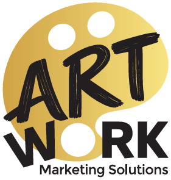

# ART WORK — Marketing Solutions
> **Kinetic Stage Edition | Experiential Marketing & Arena Scenography**



An interdisciplinary marketing and experiential design collective translating bold cultural visions into arena-scale reality.

---

## ⚡ Key Highlights & Architecture

- **Next.js 15.2 (App Router) & React 19:** Zero-hydration penalty, static prerendering, and optimized chunk delivery.
- **Tailwind CSS v4:** Modern styling with customized comic brutalist aesthetics, drop shadows (`shadow-[3px_3px_0px_#111111]`), and highlighter callouts.
- **Three.js WebGL Cinematic Background:** Real-time drafting grid with wireframe icosahedrons and dynamic perspective camera reacting to scroll progress at subtle 25% opacity.
- **Interactive Disappearing Ink Studio Pen:** 60 FPS HTML5 canvas drawing engine with high-DPI scaling and auto-fading canary yellow (`#FACC15`) strokes.
- **Pinned Scrollytelling Viewport:** Calibrated specifically for 15" laptop screens and responsive mobile devices with multi-stage scene transitions.
- **Audio Sound FX Engine:** Web Audio API synth triggers for pop, swoosh, and clicks with a sleek circular sound toggle.
- **100% Lucide SVG Icons:** Zero webfont latency and zero text-ligature flash.

---

## 🛠 Tech Stack

- **Framework:** [Next.js 15.2](https://nextjs.org/)
- **UI & State:** [React 19](https://react.dev/), [Zustand](https://zustand-demo.pmnd.rs/)
- **Styling:** [Tailwind CSS v4](https://tailwindcss.com/)
- **3D & Animation:** [Three.js](https://threejs.org/), [Framer Motion](https://www.framer.com/motion/), [GSAP](https://gsap.com/)
- **Smooth Scroll:** [@studio-freight/lenis](https://github.com/darkroomengineering/lenis)
- **Icons:** [Lucide React](https://lucide.dev/)
- **Testing:** [Playwright](https://playwright.dev/)

---

## 🚀 Getting Started

### 1. Install Dependencies
```bash
npm install
```

### 2. Run Development Server
```bash
npm run dev
```
Open [http://localhost:3000](http://localhost:3000) to view the application.

### 3. Build for Production
```bash
npm run build
```

---

## 📄 License
© 2025 Art Work Collective. All rights reserved.
