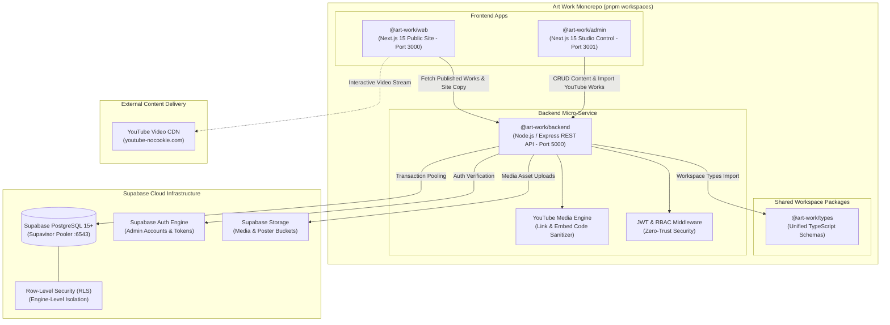

# Art Work Digital Platform — Complete Backend Engineering Blueprint
## Supabase (PostgreSQL 15+, RLS, Storage) + Node.js (TypeScript/Express)

```text
=================================================================================================
PROJECT:          Art Work — Creative Marketing Solutions (Kinetic Stage Edition)
SYSTEM:           Turborepo Monorepo Backend Service & Persistence Architecture
RUNTIME:          Node.js 20+ (TypeScript / Express) + Supabase Managed PostgreSQL
WORKSPACE ROOT:   E:\programming\Space Work\Art Work\
SERVICES:         apps/web (:3000) | apps/admin (:3001) | backend (:5000) | packages/types
PERSISTENCE:      PostgreSQL 15+ with Supavisor Connection Pooling & Zero-Trust RLS
ORCHESTRATION:    Docker Multi-Stage, GitHub Actions CI/CD, Automated SQL Migrations
=================================================================================================
```

---

## 1. System Topology & Monorepo Architecture

The backend is engineered as a first-class citizen of the Art Work Monorepo. It interfaces with Supabase for data integrity, authentication, and asset storage, while providing high-throughput REST APIs to both the public marketing site (`@art-work/web`) and the studio administration panel (`@art-work/admin`).



---

## 2. The 10 Implementation Phases (Detailed Breakdown)

Every phase includes three non-negotiable pillars:
1. **Core Backend Engineering**: Production-ready code, schemas, and API design.
2. **Automated Unit & Integration Testing**: Rigorous automated checks with Vitest, Supertest, and isolated in-memory PostgreSQL (PGlite).
3. **DevOps & Infrastructure**: Docker containerization, CI/CD pipelines, migration execution, and production monitoring.

---

### Phase 1: Backend Monorepo Workspace & Environment Architecture

#### Objective
Initialize `@art-work/backend` inside the monorepo, establish strict runtime configuration validation using Zod, and containerize the service for identical development and production execution.

#### Implementation Details
- **Directory Structure:**
  ```text
  backend/
  ├── src/
  │   ├── app.ts                 # Express application factory
  │   ├── server.ts              # Entry point with graceful shutdown
  │   ├── config/
  │   │   └── env.ts             # Strict Zod schema for environment variables
  │   └── middleware/
  │       ├── errorHandler.ts    # Centralized JSON error formatting
  │       └── requestLogger.ts   # Structured request tracing
  ├── test/                      # Vitest test suites
  ├── Dockerfile                 # Multi-stage production container
  ├── docker-compose.yml         # Local stack orchestration
  ├── tsconfig.json              # Strict TypeScript settings
  └── package.json               # Package definition with monorepo links
  ```
- **Zod Environment Contract (`src/config/env.ts`):**
  Ensures the application refuses to start if any secret is missing or misformatted:
  `PORT` (default 5000), `NODE_ENV` (`development | production | test`), `SUPABASE_URL`, `SUPABASE_SERVICE_ROLE_KEY`, `SUPABASE_ANON_KEY`, `CORS_ORIGIN`.
- **Monorepo Linkage:** Configured in `pnpm-workspace.yaml` and integrated into `turbo.json` so `pnpm build` builds the backend alongside `web` and `admin`.

#### Unit & Integration Testing
- Framework: **Vitest**
- Test Specs:
  - `test/unit/env.spec.ts`: Asserts application crashes with clear error messages when critical environment variables are absent.
  - `test/unit/health.spec.ts`: Validates `GET /api/health` returns `200 OK` with system uptime, memory metrics, and timestamp.
  - `test/unit/errorHandler.spec.ts`: Confirms that unexpected exceptions never leak internal server paths or stack traces in production mode.

#### DevOps & Infrastructure
- **Multi-Stage Dockerfile:**
  - `Stage 1 (Builder)`: Installs dependencies and runs `tsc` to produce optimized JavaScript in `dist/`.
  - `Stage 2 (Runner)`: Copies compiled output onto an ultra-lightweight `node:20-alpine` image (< 130MB footprint), running under an unprivileged `node` user for security.
- **Turbo Pipeline:** Configures caching rules for `backend#build`, `backend#test`, and `backend#lint`.

---

### Phase 2: Supabase Project Setup, Database Connection & Pooling

#### Objective
Connect Node.js to Supabase PostgreSQL using resilient connection pooling (Supavisor), configuring automatic retry backoff and leak-free connection management.

#### Implementation Details
- **Hybrid Connection Architecture:**
  - **Supabase JS Client (`@supabase/supabase-js`)**: Initialized with `SUPABASE_SERVICE_ROLE_KEY` for administrative tasks, authentication validation, and storage operations.
  - **Native PostgreSQL Pool (`pg.Pool`)**: Connected to Supavisor (Port 6543) in transaction mode for high-throughput queries:
    - Max connections: 20
    - Idle timeout: 30,000ms
    - Connection timeout: 5,000ms
- **Resilience Wrapper (`src/db/client.ts`):** Implements an exponential backoff retry mechanism (3 attempts: 200ms, 800ms, 2000ms) for transient network hiccups.

#### Unit & Integration Testing
- Test Specs:
  - `test/unit/db-connection.spec.ts`: Executes a test handshake query (`SELECT NOW()`) and confirms latency is within acceptable thresholds (< 50ms).
  - `test/unit/db-retry.spec.ts`: Simulates connection timeouts using mocked network failures to verify exponential backoff triggers correctly.
  - `test/unit/db-pool-drain.spec.ts`: Confirms idle connections are reclaimed and the pool shuts down cleanly on `SIGTERM`.

#### DevOps & Infrastructure
- Dedicated readiness probe: `GET /api/health/db` queried by Kubernetes/Docker orchestrators before routing traffic.
- Secure secrets storage across staging and production environments using encrypted secret managers.

---

### Phase 3: Relational Schema Design & Declarative Migrations (DDL)

#### Objective
Design normalized, indexed PostgreSQL schemas that persist gallery projects, YouTube embed links, site copy, and client contact leads, managed through versioned SQL migration files.

#### Implementation Details
- **SQL Migration Directory:** `supabase/migrations/` and `backend/migrations/`.
- **Database Tables:**
  1. `projects`:
     - `id UUID PRIMARY KEY DEFAULT gen_random_uuid()`
     - `slug TEXT UNIQUE NOT NULL`
     - `title TEXT NOT NULL`, `client TEXT NOT NULL`
     - `category project_category_enum NOT NULL` (`'stage' | 'conferences' | 'booths' | 'branding' | 'tech' | 'led'`)
     - `tags TEXT[] NOT NULL DEFAULT '{}'`
     - `stamp TEXT NOT NULL`, `meta_badge TEXT NOT NULL`, `cad_id TEXT NOT NULL`
     - `image_url TEXT NOT NULL`, `alt_text TEXT NOT NULL`
     - `stats TEXT NOT NULL`, `stats_sub TEXT NOT NULL`
     - `description TEXT NOT NULL`
     - `specs TEXT[] NOT NULL DEFAULT '{}'`
     - `status publication_status_enum NOT NULL DEFAULT 'draft'` (`'published' | 'draft'`)
     - `order_index INTEGER NOT NULL DEFAULT 0`
     - `featured BOOLEAN NOT NULL DEFAULT false`
     - `youtube_url TEXT` (YouTube channel video or shorts link)
     - `youtube_embed_code TEXT` (Sanitized embed URL / iframe snippet)
     - `created_at TIMESTAMPTZ NOT NULL DEFAULT now()`
     - `updated_at TIMESTAMPTZ NOT NULL DEFAULT now()`
  2. `site_content`:
     - `section_key TEXT PRIMARY KEY` (`'manifesto' | 'why_us_teaser' | 'contact' | 'why_us_page'`)
     - `data JSONB NOT NULL` (Structured content matching `@art-work/types`)
     - `version TEXT NOT NULL`
     - `updated_at TIMESTAMPTZ NOT NULL DEFAULT now()`
  3. `inquiries`:
     - `id UUID PRIMARY KEY DEFAULT gen_random_uuid()`
     - `full_name TEXT NOT NULL`, `email TEXT NOT NULL`
     - `service_type TEXT NOT NULL`, `brief TEXT NOT NULL`
     - `status TEXT NOT NULL DEFAULT 'pending'` (`'pending' | 'reviewed' | 'archived'`)
     - `created_at TIMESTAMPTZ NOT NULL DEFAULT now()`
- **High-Performance Indexing:**
  - Partial Index for public queries: `CREATE INDEX idx_projects_published ON projects (order_index) WHERE status = 'published';`
  - GIN Index for array tag searches: `CREATE INDEX idx_projects_tags ON projects USING GIN (tags);`
  - Unique Index: `CREATE UNIQUE INDEX idx_projects_slug ON projects (slug);`

#### Unit & Integration Testing
- Uses **PGlite** (in-memory embedded PostgreSQL) for zero-dependency local test execution:
  - `test/unit/schema-constraints.spec.ts`: Asserts non-null constraints, unique slug violations, and valid enum values.
  - `test/unit/migration-integrity.spec.ts`: Executes migrations from scratch, runs rollbacks, and verifies database integrity.

#### DevOps & Infrastructure
- Migration automation script: `pnpm db:migrate` runs during deployment before starting the application.
- Seeding script: `pnpm db:seed` inserts default verified arena projects and copy into empty databases.
- Automated migration linting in CI to detect table locking hazards (e.g., adding non-null columns without defaults).

---

### Phase 4: Row-Level Security (RLS) & Zero-Trust Access Control

#### Objective
Enforce PostgreSQL Row-Level Security policies at the database engine level so data exposure is strictly prohibited regardless of API code behavior.

#### Implementation Details
- **RLS Activation:**
  ```sql
  ALTER TABLE projects ENABLE ROW LEVEL SECURITY;
  ALTER TABLE site_content ENABLE ROW LEVEL SECURITY;
  ALTER TABLE inquiries ENABLE ROW LEVEL SECURITY;
  ```
- **Policy Definitions:**
  1. **Public Read-Only Access:**
     - Anonymous users can only `SELECT` published projects:
       `USING (status = 'published')`
     - Anonymous users can `SELECT` site content:
       `USING (true)`
  2. **Public Client Intake:**
     - Anonymous users can `INSERT` into `inquiries`:
       `WITH CHECK (true)`
     - Anonymous users **cannot** read or modify previous inquiries.
  3. **Admin Full Access:**
     - Authenticated admin sessions (`auth.jwt() -> role = 'admin'`) have full `SELECT`, `INSERT`, `UPDATE`, `DELETE` permissions on all tables.

#### Unit & Integration Testing
- Test Specs:
  - `test/unit/rls-public.spec.ts`: Simulates unauthenticated queries; confirms draft projects are completely hidden.
  - `test/unit/rls-tamper.spec.ts`: Attempts unauthorized `INSERT/UPDATE/DELETE` queries using anon credentials; asserts PostgreSQL error code `42501` (insufficient privileges).
  - `test/unit/rls-admin.spec.ts`: Validates that service-role or admin JWT successfully queries drafts and mutates records.

#### DevOps & Infrastructure
- Supabase Linter (`splinter`) executed in GitHub Actions to detect security regressions or missing policies.
- Automated security audit report generated on every release.

---

### Phase 5: YouTube Media Engine & Video Embed Importer

#### Objective
Build a specialized media processing engine that parses YouTube video links, extracts canonical video IDs, generates secure embed codes, and fetches high-definition preview thumbnails.

#### Implementation Details
- **YouTube Link Resolver (`src/services/youtube.service.ts`):**
  - Handles all standard YouTube input formats:
    - Standard watch: `https://www.youtube.com/watch?v=ScMzIvxBSi4`
    - Shortened share: `https://youtu.be/ScMzIvxBSi4`
    - YouTube Shorts: `https://www.youtube.com/shorts/ScMzIvxBSi4`
    - Raw embed iframe: `<iframe src="https://www.youtube.com/embed/ScMzIvxBSi4" ...></iframe>`
  - Extracts the exact 11-character video ID using strict regular expressions.
  - Constructs a privacy-enhanced, responsive embed URL:
    `https://www.youtube-nocookie.com/embed/${videoId}?autoplay=0&rel=0&modestbranding=1`
  - Generates sanitized, accessible HTML iframe markup with `loading="lazy"` and `allow="accelerometer; autoplay; clipboard-write; encrypted-media; gyroscope; picture-in-picture"`.
- **Poster Thumbnail Fetcher:**
  - Automatically fetches high-resolution video thumbnail:
    `https://img.youtube.com/vi/${videoId}/maxresdefault.jpg` with fallback to `hqdefault.jpg`.
  - Optionally stores the image in Supabase Storage (`gallery-assets`) for offline resilience.

#### Unit & Integration Testing
- Test Specs:
  - `test/unit/youtube-parser.spec.ts`: Tests 20+ URL variations, edge-case query strings, and raw iframe snippets.
  - `test/unit/youtube-xss-sanitize.spec.ts`: Proves that malicious script injection or invalid protocols in iframe embed inputs are rejected or sanitized.
  - `test/unit/youtube-thumbnail.spec.ts`: Verifies thumbnail URL generation and aspect ratio validation.

#### DevOps & Infrastructure
- Strict Content Security Policy (CSP) headers configured to whitelist YouTube frame sources:
  `frame-src 'self' https://www.youtube-nocookie.com https://www.youtube.com;`
- CDN cache headers configured for processed video thumbnails.

---

### Phase 6: RESTful API & CRUD Endpoints for Gallery Projects

#### Objective
Implement high-performance RESTful API endpoints for gallery showcase projects with filtering, full-text search, pagination, and atomic reordering.

#### Implementation Details
- **API Routes (`src/routes/projects.routes.ts`):**
  - `GET /api/projects`: Public listing with category filter (`?category=stage`), full-text search (`?q=arena`), and pagination (`?page=1&limit=10`).
  - `GET /api/projects/:idOrSlug`: Retrieve detailed project record by stable ID or slug.
  - `POST /api/projects`: Create project (Admin authenticated; validates schema and YouTube link).
  - `PUT /api/projects/:id`: Update existing project.
  - `DELETE /api/projects/:id`: Remove project with cascading checks.
  - `PATCH /api/projects/reorder`: Atomic transaction updating `order_index` across multiple projects in a single database round-trip.
- **Validation Middleware:** Zod schemas enforcing required fields, valid YouTube URLs, image paths, and technical specs arrays.

#### Unit & Integration Testing
- Test Specs using **Supertest**:
  - `test/integration/projects-crud.spec.ts`: Full lifecycle test creating, updating, inspecting, and deleting projects.
  - `test/integration/projects-validation.spec.ts`: Asserts `400 Bad Request` with structured error details when required fields are missing.
  - `test/integration/projects-reorder.spec.ts`: Tests bulk reordering and verifies no duplicate order indexes are produced.

#### DevOps & Infrastructure
- In-memory / Redis caching for `GET /api/projects` with tag-based cache eviction upon any mutation.
- Rate limiting middleware: 100 requests/minute for public viewers; 300 requests/minute for authenticated admin sessions.
- Structured JSON logging with request duration, status code, and correlation ID using Morgan and Winston.

---

### Phase 7: Site Content Versioning & Dynamic Content API

#### Objective
Provide atomic editing, history tracking, and rollback capabilities for public website copy (Manifesto, Why-Us Teaser, Contact, and Why-Us Page).

#### Implementation Details
- **API Routes (`src/routes/content.routes.ts`):**
  - `GET /api/content`: Returns the complete compiled `SiteContent` tree for client consumption.
  - `PUT /api/content/:section`: Updates a targeted section (`manifesto`, `whyUsTeaser`, `contact`, `whyUsPage`).
  - `GET /api/content/history`: Lists previous revision timestamps, editors, and changed keys.
  - `POST /api/content/rollback/:revisionId`: Restores content to a specific historical snapshot.
- **PostgreSQL Audit Trigger:**
  A database trigger automatically copies the prior record state into a `content_audit_log` table before every update, capturing old/new JSON diffs.

#### Unit & Integration Testing
- Test Specs:
  - `test/integration/content-api.spec.ts`: Verifies complete data tree serialization against `@art-work/types`.
  - `test/integration/content-mutation.spec.ts`: Tests partial updates (e.g., updating headline part 1 without altering metrics).
  - `test/integration/content-rollback.spec.ts`: Tests snapshot rollback and confirms data matches previous state.

#### DevOps & Infrastructure
- Next.js On-Demand Revalidation Webhook:
  When content is saved in `@art-work/admin`, the backend sends a cryptographically signed webhook to `@art-work/web` (`/api/revalidate?tag=site-content`), updating the public site instantly without requiring a full redeployment.

---

### Phase 8: Client Lead Intake & Notification Pipeline

#### Objective
Build a robust, spam-protected client brief intake pipeline with transactional email dispatch and database persistence.

#### Implementation Details
- **Endpoint:** `POST /api/contact/brief`
- **Submission Workflow:**
  1. Payload validation with Zod (`fullName`, `email`, `serviceType`, `brief`).
  2. Anti-spam checks:
     - Hidden honeypot field check.
     - Submission time-gate (discards submissions completed in under 1.5 seconds).
     - IP-based rate limiting (maximum 5 submissions per IP per hour).
  3. Store intake record in `inquiries` table.
  4. Dispatch transactional email alert via **Resend** or **Nodemailer** to `studio@artwork-solutions.stage` using an HTML template styled with the Art Work brand aesthetic.
  5. Send auto-reply acknowledgment email to the client.

#### Unit & Integration Testing
- Test Specs:
  - `test/unit/intake-validation.spec.ts`: Confirms email format validation, required fields, and character limits.
  - `test/unit/spam-defense.spec.ts`: Verifies honeypot detection and time-gate rejection.
  - `test/unit/email-dispatcher.spec.ts`: Mocks the email transport layer to assert correct template variables, subject line, and recipient address.

#### DevOps & Infrastructure
- Async background queue: Email sending runs asynchronously so client HTTP requests complete in < 150ms.
- Real-time studio notification webhook (Slack / Discord) alerting the creative director instantly when a brief is submitted.

---

### Phase 9: Secure Admin Authentication, Session Middleware & CORS

#### Objective
Implement secure administrative authentication using Supabase Auth, verify JWT sessions in Node.js middleware, and enforce strict CORS policies.

#### Implementation Details
- **Authentication Routes (`src/routes/auth.routes.ts`):**
  - `POST /api/auth/login`: Authenticates administrator via Supabase Auth; sets secure, `HttpOnly`, `SameSite=Lax` cookies for the access token.
  - `POST /api/auth/logout`: Clears session cookies and revokes tokens.
  - `GET /api/auth/me`: Returns current administrator profile and permissions.
- **Authentication Middleware (`src/middleware/auth.ts`):**
  - Extracts and verifies JWT from `HttpOnly` cookie or `Authorization: Bearer <token>` header.
  - Confirms token signature against Supabase JWT secret and checks `role === 'admin'`.
- **Security Headers & CORS:**
  - **Helmet**: Disables `X-Powered-By`, enables HSTS, X-Content-Type-Options, and frame options.
  - **CORS**: Strictly restricted to `http://localhost:3000` (Web), `http://localhost:3001` (Admin), and verified production domain names.

#### Unit & Integration Testing
- Test Specs:
  - `test/unit/auth-middleware.spec.ts`: Tests `401 Unauthorized` for missing/expired tokens; tests `403 Forbidden` for non-admin tokens.
  - `test/unit/cors.spec.ts`: Tests that unlisted origins are blocked with CORS rejection headers.
  - `test/unit/security-headers.spec.ts`: Asserts Helmet security headers are present on all responses.

#### DevOps & Infrastructure
- Automated dependency vulnerability scanning (`pnpm audit` / Snyk) in CI.
- Secret rotation procedure documented for the Supabase Service Role Key and JWT Secret.

---

### Phase 10: End-to-End Integration, CI/CD Pipelines & Production Deployment

#### Objective
Wire `@art-work/web` and `@art-work/admin` to the live backend, automate full test suites across all packages, and deploy the production services.

#### Implementation Details
- **Frontend Wiring:**
  - `@art-work/web` calls `GET /api/projects` and `GET /api/content` on the server.
  - `@art-work/admin` sends authenticated mutations to the backend API.
- **Full End-to-End Verification:**
  - Admin logs in -> creates a new showcase project with a YouTube video embed link -> saves -> backend validates and stores in Supabase -> public `/gallery` renders the project with a live interactive YouTube player modal.

#### Unit, Integration & E2E Testing
- Comprehensive test run across the entire monorepo:
  ```bash
  pnpm test
  ```
- Playwright E2E integration test:
  - Validates full interaction lifecycle from admin dashboard to public site.

#### DevOps & Production Delivery
- **GitHub Actions Workflows (`.github/workflows/`):**
  1. `ci.yml`: Runs `pnpm install`, `turbo run lint`, `turbo run type-check`, `turbo run test`, and `turbo run build` across all 4 monorepo packages.
  2. `deploy-migrations.yml`: Runs `pnpm db:migrate` against the production Supabase database.
  3. `deploy-backend.yml`: Builds Docker container and deploys `@art-work/backend` to Railway / Render / AWS ECS / Fly.io.
  4. `deploy-apps.yml`: Deploys `@art-work/web` and `@art-work/admin` to Vercel.
- **Production Observability:**
  - Sentry error monitoring and performance tracing.
  - Health check monitor (UptimeRobot / BetterStack) polling `/api/health` every 60 seconds.
  - Automated daily PostgreSQL backups configured in Supabase.

---

## 3. Technology Stack Reference

| Layer | Technology | Key Responsibility |
| :--- | :--- | :--- |
| **Monorepo Engine** | Turborepo + pnpm | Parallel builds, caching, package linkage |
| **Backend Runtime** | Node.js 20+ (TypeScript / Express) | REST API endpoints, business logic, validation |
| **Database** | Supabase Managed PostgreSQL 15+ | Relational data persistence, indexes, constraints |
| **Connection Pooling** | Supavisor (Port 6543) | Transaction-level connection pooling |
| **Security Layer** | Supabase Row-Level Security (RLS) | Database engine-level authorization |
| **Authentication** | Supabase Auth + JWT Middleware | Secure admin credentials & role enforcement |
| **Media Engine** | YouTube Embed Engine + Storage | Video ID extraction, privacy embeds, posters |
| **Validation** | Zod | Runtime schema validation across all inputs |
| **Unit Testing** | Vitest + Supertest + PGlite | Fast, isolated unit and API integration testing |
| **Containerization** | Docker Multi-Stage | Minimal, secure Alpine production images |
| **CI/CD** | GitHub Actions | Automated lint, test, migration, and deployment |
| **Frontend Clients** | Next.js 15 App Router | `@art-work/web` (:3000) & `@art-work/admin` (:3001) |
