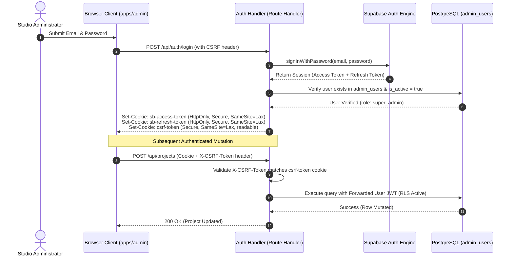
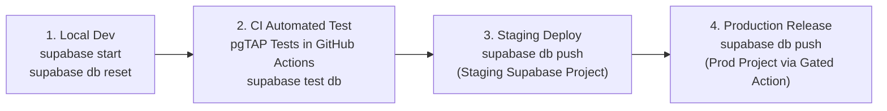
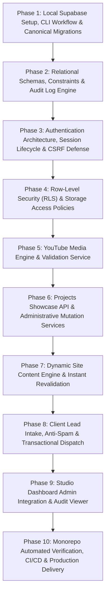

# Art Work Digital Platform — Revised Backend Engineering Blueprint
## Architecture, Access-Control Model, Relational Schemas & 10 Implementation Phases
### Supabase (PostgreSQL 15+, RLS, SSR Auth, Storage) + Modern Node.js Architecture

```text
===================================================================================================
PROJECT:          Art Work — Creative Marketing Solutions (Kinetic Stage Edition)
SYSTEM:           Turborepo Monorepo Full-Stack Architecture & Data Persistence Engine
REVISION:         v2.0.0 (Production Security, Unified Access Control & Schema Integrity)
WORKSPACE ROOT:   E:\programming\Space Work\Art Work\
SERVICES:         apps/artwork-app (:3000) | apps/admin (:3001) | packages/types
DATABASE:         PostgreSQL 15+ via Supabase with Supavisor Connection Pooling
ACCESS CONTROL:   Dual-Boundary Defense (Verified JWT Session + Database-Engine RLS)
===================================================================================================
```

---

## 1. Architectural Decision Record (ADR-001): Topology & Service Reassessment

### Context & Challenge
The previous architecture proposal introduced three independent server runtimes:
1. `apps/artwork-app` (Next.js 15 marketing site on `:3000`)
2. `apps/admin` (Next.js 15 studio dashboard on `:3001`)
3. `backend` (Standalone Express.js REST API on `:5000`)

### Comparison Matrix

| Evaluation Criteria | Option A: Monorepo with Standalone Express Microservice (`:5000`) | Option B: Monorepo with Next.js SSR + Supabase SDK (Recommended) | Option C: Single Next.js Monolith (`/admin` in main app) |
| :--- | :--- | :--- | :--- |
| **Separation of Concerns** | High (Independent HTTP service) | High (Separate admin app, clean boundaries) | Low (Admin coupled into client bundle) |
| **User Requirement Alignment** | Meets monorepo requirement | **Strictly honors "Dashboard as completely separate app in monorepo"** | Violates explicit user directive |
| **Operational Overhead** | High (3 servers to deploy, monitor, and scale) | **Low (2 Next.js apps deployed to Vercel/Node, 0 microservice maintenance)** | Very Low |
| **Authentication & Cookies** | Complex (Cross-origin CORS, cross-domain `SameSite` cookies) | **Seamless (`@supabase/ssr` with standard same-origin HttpOnly cookies)** | Seamless |
| **Latency & Overhead** | 2 Network Hops (Browser -> Express -> Supabase) | **1 Direct Hop (Next.js Server Actions / Handlers -> Supabase)** | 1 Direct Hop |
| **Database Connection Limits** | Express maintains persistent connection pool | **Serverless-friendly via Supavisor Transaction Pooler (`:6543`)** | Serverless-friendly |
| **Code Duplication** | High (Express controllers mirror Next.js fetchers) | **Minimal (Shared `@art-work/types` package across both apps)** | Minimal |

### Architectural Recommendation
**Adopt Option B (The Streamlined Monorepo Architecture)**:
- Maintain two decoupled applications within the Turborepo monorepo:
  - `apps/artwork-app`: Public showcase site.
  - `apps/admin`: Standalone studio management dashboard.
  - `packages/types`: Canonical TypeScript contracts shared across the entire workspace.
- **Backend Functionality**: Implemented via type-safe Next.js Route Handlers (`app/api/*`) and Server Actions backed directly by `@supabase/ssr` and Supabase PostgreSQL. 
- *Note:* If an external client (mobile app or third-party CRM) requires an independent REST server in the future, the shared services in `packages/` can be wrapped in a lightweight Express microservice without rewriting database schemas or business logic.

---

## 2. Core Access Control & Database Access Model

### 2.1 The Single Source of Truth for Security
Previous drafts conflated API middleware checks with database-level RLS while proposing to run queries with `SUPABASE_SERVICE_ROLE_KEY`.

> [!CAUTION]
> **Fundamental Security Axiom:** 
> Queries executed using the Supabase `service_role` key **bypass PostgreSQL Row-Level Security completely**. Claiming that RLS protects `service_role` operations is false and creates severe security vulnerabilities.

### 2.2 Dual-Boundary Defense-in-Depth Model
The revised architecture establishes two explicit, non-overlapping enforcement boundaries:

```mermaid
flowchart TD
    Client["Browser / Admin Client"] -->|HTTPS + HttpOnly Cookie / Bearer JWT| Boundary1["Boundary 1: API & Application Gateway"]
    
    subgraph Boundary1Layer ["Enforcement Boundary 1: Application Layer (Next.js / Node API)"]
        CSRF["CSRF Protection\n(SameSite + Header Validation)"]
        RateLimit["Rate Limiting & Abuse Defense"]
        SchemaVal["Zod Schema & Input Sanitization"]
        AuthVerify["Supabase Auth Session Verification"]
    end
    
    Boundary1 --> CSRF --> RateLimit --> SchemaVal --> AuthVerify
    
    AuthVerify -->|Forward Authenticated User Context\n(Scoped Client with User JWT)| Boundary2["Boundary 2: PostgreSQL Engine"]
    
    subgraph Boundary2Layer ["Enforcement Boundary 2: Database Layer (PostgreSQL 15+)"]
        PostgresConn[("Supavisor Pooler (:6543)\nprepare: false")]
        RLSEngine{"Row-Level Security (RLS)\nauth.uid() Evaluation"}
        AdminFunc["public.is_admin()\nSecurity Definer Check"]
        TableData[("Tables: projects, site_content,\ninquiries, content_audit_logs")]
    end
    
    Boundary2 --> PostgresConn --> RLSEngine
    RLSEngine --> AdminFunc
    AdminFunc --> TableData
```

1. **Boundary 1: Application Layer (API & Server Actions)**
   - **Enforcement**: Validates incoming payloads using strict Zod schemas, enforces rate limits, validates CSRF tokens on mutations, and extracts verified JWT user identities.
   - **User Context Forwarding**: The application server never executes routine queries with `service_role`. Instead, it initializes a scoped Supabase client with the user's verified session token (`auth.uid()`), passing the authenticated context directly to PostgreSQL.

2. **Boundary 2: Database Engine Layer (PostgreSQL RLS)**
   - **Enforcement**: PostgreSQL evaluates policies on every row. Even if application code has a bug or an internal query omits a `WHERE` clause, the database engine guarantees that:
     - Anonymous users cannot read draft projects or audit logs.
     - Anonymous users cannot modify or delete any record.
     - Only verified members of `public.admin_users` can mutate published data.

3. **Restricted Use of `service_role`**:
   The `service_role` key is strictly isolated to:
   - Initial administrative bootstrap scripts (seeding the first super-admin).
   - System auth administration (inviting administrators via the Supabase Auth Admin API).
   - It is **strictly prohibited** in standard REST routes, server actions, and frontend-facing endpoints.

---

## 3. Trusted Admin Authorization Architecture

### 3.1 Eliminating Naive `role = 'admin'` Claims
Supabase `user_metadata` is writable by clients in certain default configurations, and default Supabase Auth JWTs assign `role: 'authenticated'` to all logged-in users regardless of privilege. 

### 3.2 Canonical Admin Membership Table (`public.admin_users`)
Administrative privileges are governed strictly by a dedicated relational membership table:

```sql
CREATE TYPE public.admin_role_enum AS ENUM ('super_admin', 'editor', 'viewer');

CREATE TABLE public.admin_users (
    user_id UUID PRIMARY KEY REFERENCES auth.users(id) ON DELETE CASCADE,
    email TEXT UNIQUE NOT NULL,
    full_name TEXT NOT NULL,
    role public.admin_role_enum NOT NULL DEFAULT 'editor',
    is_active BOOLEAN NOT NULL DEFAULT true,
    created_at TIMESTAMPTZ NOT NULL DEFAULT now(),
    updated_at TIMESTAMPTZ NOT NULL DEFAULT now()
);

-- Index for instant RLS lookups
CREATE INDEX idx_admin_users_lookup ON public.admin_users (user_id) WHERE is_active = true;
```

### 3.3 Security Definer Authorization Helper
To prevent recursive RLS queries and ensure maximum execution speed, authorization checks use an isolated PostgreSQL function:

```sql
CREATE OR REPLACE FUNCTION public.is_admin()
RETURNS BOOLEAN
LANGUAGE sql
SECURITY DEFINER
SET search_path = public
STABLE
AS $$
  SELECT EXISTS (
    SELECT 1 
    FROM public.admin_users
    WHERE user_id = auth.uid() 
      AND is_active = true
  );
$$;
```

### 3.4 Admin Assignment Workflow
- **Initial Bootstrap**: Provisioned via secure migration or CLI seed script with a dedicated UUID.
- **Subsequent Admins**: Created exclusively through an administrative RPC (`invite_admin_user`) callable only by users possessing the `super_admin` role.

---

## 4. Authentication, Session Lifecycle & CSRF Security

Authentication and identity design precedes all database security policies.



### Session Details & Security Parameters
1. **HttpOnly Cookies**: Raw JWT tokens are **never** accessible to client-side JavaScript.
2. **Refresh Token Rotation**: Handled transparently by `@supabase/ssr` during Server Component and Route Handler invocations.
3. **Logout**: Invalidates the active session in `auth.sessions` and explicitly unsets all cookies.
4. **CSRF Mitigation**:
   - Mutations require a custom request header (`X-Requested-With: XMLHttpRequest` or `X-CSRF-Token`).
   - Browser cross-origin requests cannot set custom headers without passing CORS preflight checks.

---

## 5. Media Security: Validated YouTube Storage & Sandboxed Rendering

### 5.1 Storage Rules (No Raw Iframe HTML)
Storing arbitrary `<iframe>` HTML in PostgreSQL exposes the application to Cross-Site Scripting (XSS) and invalid markup injection.

**Rules for Database Persistence:**
- Store **only** the validated 11-character YouTube Video ID (`youtube_video_id`).
- Store the canonical share URL (`youtube_url`) for editorial reference.
- **Never store `<iframe>` HTML snippets in the database.**

### 5.2 Video ID Validation Schema (Zod & SQL Constraint)
- **SQL Constraint**:
  ```sql
  CHECK (youtube_video_id IS NULL OR youtube_video_id ~ '^[a-zA-Z0-9_-]{11}$')
  ```
- **Zod Validator**:
  ```typescript
  export const YouTubeIdSchema = z.string().regex(/^[a-zA-Z0-9_-]{11}$/, "Invalid 11-character YouTube Video ID");
  ```

### 5.3 Dynamic Sandboxed Rendering
When displaying video showcases, the client or server component constructs the embed URL dynamically:
- **Approved Origin**: `https://www.youtube-nocookie.com/embed/${youtube_video_id}`
- **Security Parameters**: `?autoplay=0&rel=0&modestbranding=1&enablejsapi=1`
- **Iframe Attributes**:
  ```tsx
  <iframe
    src={`https://www.youtube-nocookie.com/embed/${encodeURIComponent(project.youtube_video_id)}?rel=0&modestbranding=1`}
    title={project.title}
    loading="lazy"
    sandbox="allow-scripts allow-same-origin allow-presentation"
    allow="accelerometer; autoplay; clipboard-write; encrypted-media; gyroscope; picture-in-picture"
    className="w-full h-full rounded-2xl border-0"
  />
  ```
- **Content Security Policy (CSP)**:
  `frame-src 'self' https://www.youtube-nocookie.com;`

---

## 6. Complete Relational Database Schemas

### 6.1 Publication Status & Enums
```sql
CREATE TYPE public.content_status_enum AS ENUM ('draft', 'published', 'archived');
CREATE TYPE public.project_category_enum AS ENUM ('stage', 'conferences', 'booths', 'branding', 'tech', 'led');
```

### 6.2 Projects Showcase Table (`public.projects`)
```sql
CREATE TABLE public.projects (
    id UUID PRIMARY KEY DEFAULT gen_random_uuid(),
    slug TEXT UNIQUE NOT NULL,
    title TEXT NOT NULL,
    client TEXT NOT NULL,
    category public.project_category_enum NOT NULL,
    year INTEGER NOT NULL CHECK (year >= 2020 AND year <= 2035),
    description TEXT NOT NULL,
    tags TEXT[] NOT NULL DEFAULT '{}',
    stamp TEXT NOT NULL,               -- e.g. "ARENA // 2026"
    meta_badge TEXT NOT NULL,          -- e.g. "IMMERSIVE LED"
    cad_id TEXT NOT NULL,              -- e.g. "CAD-REV-04"
    cover_image_url TEXT NOT NULL,
    cover_image_alt TEXT NOT NULL,
    stats_primary TEXT NOT NULL,       -- e.g. "12,000+"
    stats_secondary TEXT NOT NULL,     -- e.g. "ATTENDEES"
    specs TEXT[] NOT NULL DEFAULT '{}',
    youtube_video_id VARCHAR(11) CHECK (youtube_video_id IS NULL OR youtube_video_id ~ '^[a-zA-Z0-9_-]{11}$'),
    youtube_url TEXT,
    status public.content_status_enum NOT NULL DEFAULT 'draft',
    order_index INTEGER NOT NULL DEFAULT 0,
    featured BOOLEAN NOT NULL DEFAULT false,
    created_by UUID REFERENCES auth.users(id),
    updated_by UUID REFERENCES auth.users(id),
    created_at TIMESTAMPTZ NOT NULL DEFAULT now(),
    updated_at TIMESTAMPTZ NOT NULL DEFAULT now()
);

-- Optimized Performance Indexes
CREATE INDEX idx_projects_public_listing ON public.projects (order_index ASC) 
    WHERE status = 'published';
CREATE INDEX idx_projects_category ON public.projects (category, order_index ASC) 
    WHERE status = 'published';
CREATE INDEX idx_projects_tags ON public.projects USING GIN (tags);
```

### 6.3 Site Content & CMS Copy Table (`public.site_content`)
Covers every editable heading, subhead, card, metric, label, and CTA required by the studio dashboard:

```sql
CREATE TABLE public.site_content (
    section_key TEXT PRIMARY KEY,       -- 'hero' | 'manifesto' | 'capabilities' | 'why_us' | 'scrollytelling' | 'contact'
    data JSONB NOT NULL,
    status public.content_status_enum NOT NULL DEFAULT 'published',
    version INTEGER NOT NULL DEFAULT 1,
    updated_by UUID REFERENCES auth.users(id),
    updated_at TIMESTAMPTZ NOT NULL DEFAULT now()
);
```

#### JSONB Data Contract for Each Section:
1. **`hero`**:
   ```json
   {
     "headline_highlight": "KINETIC STAGES.",
     "headline_suffix": "UNFORGETTABLE EXPERIENCES.",
     "subheadline": "We engineer architectural scenography, immersive concert stages, and interactive physical-digital brand activations.",
     "tags": ["Scenography", "Lighting Architecture", "3D Trussing", "Creative Direction"],
     "cta_primary_text": "Explore Showcase",
     "cta_primary_href": "/gallery",
     "cta_secondary_text": "Our Philosophy",
     "cta_secondary_href": "/why-us",
     "banner_badge": "WORLD TOUR 2026 PRODUCTION"
   }
   ```
2. **`capabilities`**:
   ```json
   {
     "heading": "TECHNICAL CAPABILITIES MATRIX",
     "subheading": "Comprehensive creative and spatial engineering disciplines",
     "cards": [
       {
         "id": "stage-arch",
         "title": "Stage Architecture",
         "category": "Spatial",
         "description": "Parametric truss design, acoustic engineering, and modular stage rigs.",
         "icon_name": "Layers",
         "order_index": 1
       }
     ]
   }
   ```
3. **`why_us`**:
   ```json
   {
     "heading": "WHY ART WORK",
     "manifesto_lead": "We bridge raw architectural geometry with cinematic motion.",
     "paragraphs": [
       "Our studio unites spatial designers, lighting directors, and creative technologists under one roof."
     ],
     "metrics": [
       { "label": "Global Arenas", "value": "120+", "caption": "Designed and executed" }
     ]
   }
   ```
4. **`scrollytelling`**:
   ```json
   {
     "stage_01_label": "GENESIS // THINKER",
     "stage_02_label": "COLLECTIVE // STUDIO",
     "stage_03_label": "ARCHITECTURE // BLUEPRINT",
     "sound_fx_default": true
   }
   ```
5. **`contact`**:
   ```json
   {
     "email": "studio@artwork-solutions.stage",
     "phone": "+971 4 000 0000",
     "address": "Creative Media Free Zone, Studio 04",
     "office_hours": "Sun - Thu, 09:00 - 18:00 GST"
   }
   ```

### 6.4 Client Intake Leads Table (`public.inquiries`)
```sql
CREATE TABLE public.inquiries (
    id UUID PRIMARY KEY DEFAULT gen_random_uuid(),
    full_name TEXT NOT NULL,
    email TEXT NOT NULL,
    service_type TEXT NOT NULL,
    brief TEXT NOT NULL,
    status TEXT NOT NULL DEFAULT 'pending' CHECK (status IN ('pending', 'reviewed', 'contacted', 'archived')),
    ip_hash TEXT,                       -- SHA256 hashed IP for spam defense without storing raw PII
    created_at TIMESTAMPTZ NOT NULL DEFAULT now()
);
```

### 6.5 Content Audit History Table (`public.content_audit_logs`)
Captures every administrative mutation with complete historical diffs:

```sql
CREATE TABLE public.content_audit_logs (
    id UUID PRIMARY KEY DEFAULT gen_random_uuid(),
    entity_type TEXT NOT NULL CHECK (entity_type IN ('project', 'site_content')),
    entity_id TEXT NOT NULL,
    action TEXT NOT NULL CHECK (action IN ('create', 'update', 'delete', 'publish', 'archive')),
    actor_id UUID REFERENCES auth.users(id),
    actor_email TEXT NOT NULL,
    before_state JSONB,
    after_state JSONB,
    created_at TIMESTAMPTZ NOT NULL DEFAULT now()
);

CREATE INDEX idx_audit_entity ON public.content_audit_logs (entity_type, entity_id);
```

---

## 7. Storage Rules & Connection Pooling (Supavisor)

### 7.1 Supabase Storage Bucket Security
- **Bucket**: `artwork-media` (Public bucket for fast CDN caching of gallery thumbnails and assets).
- **Access Policies (`storage.objects`)**:
  - `SELECT`: Public access allowed for all files (`bucket_id = 'artwork-media'`).
  - `INSERT / UPDATE / DELETE`: Strictly restricted to active administrators via `public.is_admin()`.
  - **Upload Safeguards**:
    - Max file size: 8 MB.
    - Allowed MIME types: `image/jpeg`, `image/png`, `image/webp`, `image/svg+xml`.

### 7.2 Supavisor Connection Pooling Configuration (Port 6543)
- When connecting Node.js clients (`pg.Pool` or Prisma/Drizzle) to Supabase's transaction pooler:
  - **Disable Prepared Statements**: Supavisor in transaction mode does not maintain prepared statements across distinct backend connections. Client libraries must be configured with `prepare: false` or the connection string must include `?pgbouncer=true`.
  - **Stateless Sessions**: Application queries must never rely on `SET session_variable` or `LISTEN/NOTIFY`.
  - **Migration Port**: DDL migrations run through direct connection (Port `5432`) or the Supabase CLI, avoiding pooler limitations.

---

## 8. Canonical Migration Directory & CI/CD Pipeline

### 8.1 Single Migration Directory
All database changes are managed exclusively in:
`supabase/migrations/`

Naming standard:
`YYYYMMDDHHMMSS_<descriptive_name>.sql`
- Example: `20261019120000_create_core_schemas.sql`
- Example: `20261019121000_create_rls_policies.sql`

### 8.2 Migration Lifecycle Across Environments



1. **Local Development**: Developers use the local Supabase CLI running in Docker. Database resets apply all migrations sequentially and execute seed scripts in `supabase/seed.sql`.
2. **Continuous Integration**: GitHub Actions spins up an ephemeral PostgreSQL instance, applies migrations from scratch, and verifies zero schema syntax errors and zero RLS linter warnings (`splinter`).
3. **Deployment**: Migrations are applied automatically prior to application deployment via `supabase db push`.

---

## 9. Deterministic Test Plan

### 9.1 Test Isolation Principles
1. **Local Deterministic Environment**:
   - All migration, schema constraint, and RLS tests run locally against the Supabase Docker container or isolated test databases.
   - Tests **never** depend on live internet connectivity or external Supabase cloud latency.
2. **Decoupled Latency Checks**:
   - Network latency benchmarks and YouTube OEMBED endpoint checks are strictly designated as **Synthetic Health Monitors**, run separately from deterministic test suites so CI pipelines never fail due to external network flakiness.

### 9.2 Automated Test Coverage Matrix

| Test Suite | Framework / Tool | Target Under Test | Success Criteria |
| :--- | :--- | :--- | :--- |
| **Schema Constraints** | Vitest + PostgreSQL | `projects`, `site_content`, `inquiries` | Rejects invalid enums, duplicate slugs, invalid video IDs |
| **RLS Policies** | pgTAP / Supabase CLI | Anonymous vs Authenticated vs Admin roles | Anon cannot read drafts; Anon cannot update; Admin has full access |
| **YouTube Media Parser** | Vitest | `YouTubeResolver` utility | Correctly extracts IDs from 15+ URL formats; rejects raw iframe HTML |
| **Auth & CSRF Guards** | Supertest / Vitest | Next.js API Route Handlers | Blocks requests lacking valid CSRF headers or session cookies |
| **Content Audit Logs** | Vitest + PostgreSQL | Mutation triggers | Verified `before_state` and `after_state` diff captured on update |

---

## 10. The Revised 10 Implementation Phases

The 10 phases are restructured in strict dependency order (Authentication & Schemas established before RLS policies):



---

### Phase 1: Local Supabase Setup, CLI Workflow & Canonical Migrations
- **Objective**: Establish the local development environment using the Supabase CLI, configure the canonical `supabase/migrations/` directory, and verify Supavisor connection pooling settings.
- **Tasks**:
  1. Initialize `supabase/config.toml` for local development.
  2. Configure connection settings for both direct port (`5432`) and Supavisor transaction pooler (`6543`) with `prepare: false`.
  3. Create migration baseline script and automated database reset command (`pnpm db:reset`).
- **Testing**: Deterministic connection test verifying database handshake and pooler compatibility.
- **DevOps**: Docker Compose / Supabase CLI local orchestration verified.

---

### Phase 2: Relational Schemas, Constraints & Audit Log Engine
- **Objective**: Deploy production DDL schemas for showcase projects, typed site content, client inquiries, and automated audit logging.
- **Tasks**:
  1. Write migration `20261019000001_core_schemas.sql` defining `projects`, `site_content`, `inquiries`, and `admin_users`.
  2. Implement database triggers capturing update timestamps and writing state diffs to `content_audit_logs`.
  3. Define partial indexes for published queries and GIN indexes for tag searches.
- **Testing**: Vitest schema validation asserting constraint enforcement (non-null, slug uniqueness, enum validity).
- **DevOps**: Schema migration linting in CI to prevent hazardous table locks.

---

### Phase 3: Authentication Architecture, Session Lifecycle & CSRF Defense
- **Objective**: Implement secure administrative authentication using Supabase Auth, HttpOnly cookie sessions, and CSRF protection.
- **Tasks**:
  1. Implement login endpoint with rate limiting (max 5 failed attempts per 15 minutes).
  2. Configure `@supabase/ssr` cookie handler managing access and refresh token rotation with `SameSite=Lax` and `HttpOnly` flags.
  3. Implement CSRF validation middleware enforcing custom token headers on all mutating routes.
  4. Create `public.admin_users` seed script for initial super-admin account.
- **Testing**: Automated integration tests verifying 401 on expired tokens, cookie clearing on logout, and CSRF rejection on missing headers.
- **DevOps**: Automated token expiry and secret rotation documentation.

---

### Phase 4: Row-Level Security (RLS) & Storage Access Policies
- **Objective**: Enforce PostgreSQL Row-Level Security policies and storage bucket rules using the verified admin membership table.
- **Tasks**:
  1. Implement `public.is_admin()` security definer function.
  2. Apply RLS policies across `projects`:
     - Public `SELECT`: `WHERE status = 'published'`
     - Admin `ALL`: `WHERE public.is_admin() = true`
  3. Apply RLS policies across `site_content`, `inquiries`, and `content_audit_logs`.
  4. Configure `artwork-media` Supabase Storage bucket with public read and admin-only upload policies.
- **Testing**: pgTAP test suite testing anonymous access vs authenticated editor vs non-admin user across all CRUD operations.
- **DevOps**: Supabase `splinter` security audit script integrated into GitHub Actions.

---

### Phase 5: YouTube Media Engine & Validation Service
- **Objective**: Build a robust YouTube media resolver that extracts 11-character video IDs, rejects raw iframe markup, and delivers sandboxed embed URLs.
- **Tasks**:
  1. Create `YouTubeResolver` service in shared package.
  2. Parse 15+ YouTube URL patterns (standard watch, shortened youtu.be, shorts, timestamps).
  3. Generate sandboxed embed parameters using `https://www.youtube-nocookie.com`.
  4. Implement high-resolution poster fallback generator (`maxresdefault.jpg` -> `hqdefault.jpg`).
- **Testing**: Vitest unit suite verifying parsing accuracy and proving that malicious script injection or invalid protocols are rejected.
- **DevOps**: Configure Content Security Policy (CSP) headers allowing YouTube nocookie frames.

---

### Phase 6: Projects Showcase API & Administrative Mutation Services
- **Objective**: Implement high-throughput read endpoints for public visitors and type-safe mutation actions for studio administrators.
- **Tasks**:
  1. Public query endpoint `GET /api/projects` with category filters, tag search, and pagination.
  2. Admin mutation endpoints (Create, Update, Delete, Reorder) executing within user-authenticated RLS context.
  3. Atomic project reordering transaction ensuring sequential `order_index`.
- **Testing**: Supertest integration tests verifying full project lifecycle and atomic reordering.
- **DevOps**: Server-side caching with tag-based invalidation (`revalidateTag('projects')`).

---

### Phase 7: Dynamic Site Content Engine & Instant Revalidation
- **Objective**: Provide typed content management for the public site's copy, metrics, and capabilities with draft/published state support.
- **Tasks**:
  1. Implement content retrieval handler returning the unified `SiteContent` tree.
  2. Implement section-specific update handlers validating payloads against `@art-work/types`.
  3. Implement on-demand revalidation trigger updating public Next.js pages instantly upon save.
- **Testing**: Integration tests validating complete JSON serialization and partial section updates.
- **DevOps**: Cache-control headers configured for edge delivery.

---

### Phase 8: Client Lead Intake, Anti-Spam & Transactional Dispatch
- **Objective**: Build a spam-resistant client brief intake pipeline with transactional email alerts and database persistence.
- **Tasks**:
  1. Public `POST /api/contact/brief` endpoint with Zod validation.
  2. Anti-spam layer: honeypot trap, minimum submission time-gate (1.5s), and IP rate limiting.
  3. Asynchronous email notification dispatch via Resend / Nodemailer to studio management.
  4. Auto-acknowledgment email sent to client.
- **Testing**: Vitest unit tests for honeypot rejection, email validation, and mocked email transport delivery.
- **DevOps**: Webhook dispatch for instant studio notifications (Slack/Discord).

---

### Phase 9: Studio Dashboard Admin Integration & Audit Viewer
- **Objective**: Connect `apps/admin` to the backend services, enabling full content editing, YouTube video management, and audit log inspection.
- **Tasks**:
  1. Integrate admin login page with Supabase Auth session management.
  2. Connect Website Content Editor (`/content`) to `site_content` endpoints.
  3. Connect Gallery Manager (`/projects`) with YouTube link parser and live preview modal.
  4. Build Audit History inspector showing historical diffs and editor details.
- **Testing**: Playwright component and end-to-end integration tests verifying admin workflows.
- **DevOps**: Sentry error logging and user session tracing.

---

### Phase 10: Monorepo Automated Verification, CI/CD & Production Delivery
- **Objective**: Verify the entire monorepo build, enforce zero-lint / zero-error gates, and automate production deployment pipelines.
- **Tasks**:
  1. GitHub Actions CI pipeline executing:
     - `pnpm install`
     - `turbo run lint`
     - `turbo run type-check`
     - `turbo run test`
     - `turbo run build`
  2. Automated migration deployment workflow running `supabase db push` against production.
  3. Production environment configuration on Vercel.
- **Testing**: Full end-to-end test suite run across all packages (`pnpm test`).
- **DevOps**: Uptime monitoring, health check pingers (`/api/health`), and automated daily database backups.

---

## 11. Assumptions & Unresolved Decisions

1. **Transactional Email Provider**: Blueprint specifies Resend or standard SMTP/Nodemailer. Exact API keys will be provided prior to Phase 8.
2. **Media Storage Volume**: Assumes image assets are hosted via Supabase Storage (< 8 MB per file). Large video files are hosted on YouTube and embedded via privacy-enhanced embeds.
3. **Deployment Strategy**: Recommends deploying both `@art-work/artwork-app` and `@art-work/admin` to Vercel with environment variables pointing to the managed Supabase instance.
